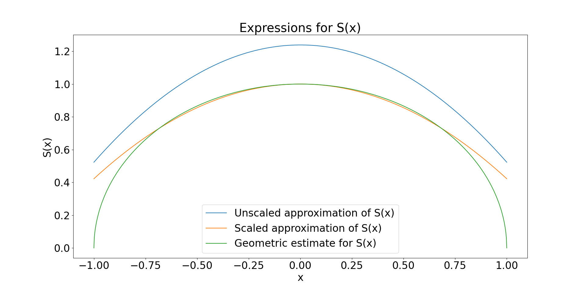
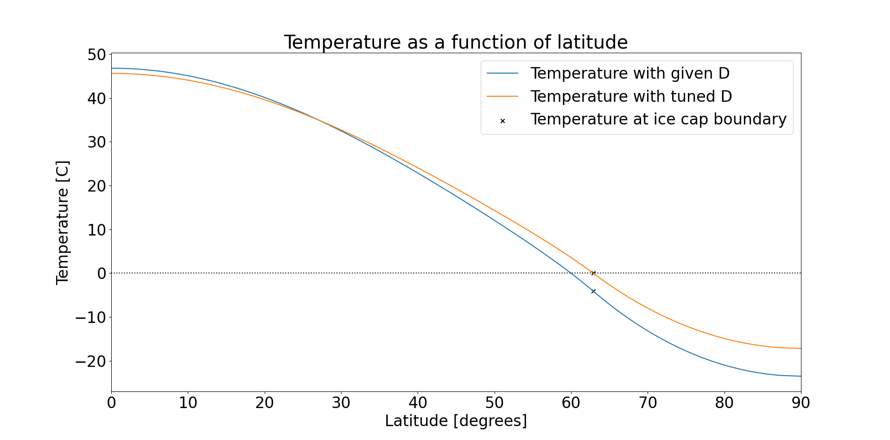

# TMA4195-Project

Group project on climate modelling in TMA4195 Mathematical Modelling at NTNU (autumn 2024), together with
[EliasKRekkedal](https://github.com/EliasKRekkedal) and [MaxPfisterer](https://github.com/MaxPfisterer).
We built simple energy balance models of the Earth and looked at their equilibria and stability.
This repo only has the code and a couple of figures, it was put here for easy distribution during grading.
The report itself isn't included.

- `matmodOppg3.py` is a two-layer model (surface and atmosphere) with shortwave and longwave fluxes
  and clouds. The equilibrium temperatures are found with Newton's method.
- `Question10.py` is a model where temperature varies with latitude and there's an ice cap. It's
  discretised with finite differences, and we check stability through the eigenvalues of the matrix.
- `exercise12.ipynb` does the linear stability analysis properly: eigenvalues for different grid sizes,
  the leading eigenmodes and how a small perturbation decays. All eigenvalues have negative real
  part, so the equilibrium is stable.

| Insolation S(x) | Temperature vs latitude |
|---|---|
|  |  |

The right plot shows the steady state with the given diffusion coefficient D and with D tuned so the
temperature at the ice cap edge is 0 °C. The code for these two figures isn't fully in the repo.

Needs numpy, scipy and matplotlib. Parameters are hard coded, so just run `python matmodOppg3.py`
or `python Question10.py`, or open the notebook.
